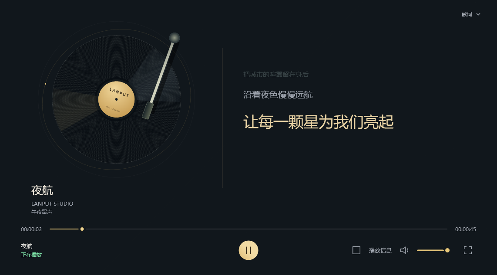

<p align="center"></p>

# LANPUT

**手机选好影片，投屏，剩下的交给 LANPUT。**

LANPUT 是一款 Windows 局域网媒体接收软件。接收影片时，观众席与银幕自动切换为播放画面；接收音乐时，影院换场至黑胶音乐厅，展示旋转唱片、歌曲信息与同步歌词。

**当前源码版本：0.9.5。** 安装包请以 Releases 页面已发布版本为准。

**平台：Windows x64 · 技术：C# / WPF / LibVLC / .NET 10 · 协议：MIT**

**Linux / macOS 客户端开发中：** 已新增独立的 Avalonia 跨平台预览客户端，复用投屏核心，接入影院、音乐与歌词。运行依赖、构建方法和当前限制见 [跨平台客户端说明](src/LANPUT.Desktop/README.md)。现有 Release 下载仍为 Windows 版；Linux / macOS 预览构建不代表已完成手机投屏实机验收。

[下载软件](https://github.com/YFFanJK/lanput/releases) · [运行要求](#运行要求与必要组件) · [使用方法](#安装与使用) · [连接排查](#手机搜索不到电脑设备) · [源码构建](#从源码构建) · [更新记录](CHANGELOG.md)

## 功能与界面

| 功能 | 说明 |
|---|---|
| 局域网投屏 | 接收手机播放器通过 SSDP / UPnP AV 投送的媒体，也支持打开本地文件 |
| 私人影院 | 观众席待机，影片自动开映、结束退场，支持最大化与全屏 |
| 黑胶音乐厅 | 识别纯音频，旋转唱片与中心标签，显示歌名、歌手和专辑 |
| 同步歌词 | LRCLIB 在线搜索并自动应用可用版本，也可导入 LRC、手动选版和校准时间 |
| 自动换场 | 影院与音乐厅合幕、换场、开幕，支持跳过；切歌、暂停不重复换场 |
| 日常控制 | 启动自动接收、网卡记忆、托盘、快捷键、音量、进度和播放信息 |
| 更新检查 | 支持配置 HTTPS 更新清单地址 |

**影院待机**


**黑胶音乐厅**（使用本地测试音频与示例歌词）



## 运行要求与必要组件

### 下载软件后直接使用

| 项目 | 要求 / 是否需要单独安装 |
|---|---|
| 操作系统 | Windows x64，推荐 Windows 11；Windows 10 需满足 [.NET 10 的系统要求](https://learn.microsoft.com/en-us/dotnet/core/install/windows)。目前主要验证 Windows 11 x64 |
| 网络 | 手机与电脑处于同一个可信局域网，电脑选择对应网卡；局域网投屏需要允许组播发现及入站通信 |
| 手机端 | 使用带投屏 / TV 入口且协议兼容的播放器；不要求另装 LANPUT 手机客户端 |
| .NET 运行时 | **发行包已包含**，安装版与便携版均为自包含发布，无需额外安装 .NET SDK 或 .NET 运行时 |
| LibVLC 播放引擎及插件 | **发行包已包含**，无需另外安装 VLC 播放器；必须保留随包 DLL 与插件 |
| Windows PowerShell | 防火墙辅助脚本使用 Windows 自带的 `powershell.exe`，无需额外安装 PowerShell 7 |
| 管理员权限 | 日常播放无需管理员权限；修改防火墙规则时需要管理员授权 |

**便携版要完整解压后再运行，不能只复制一个 `LANPUT.exe`。** 应用运行时、播放引擎、插件与辅助脚本都在同一个发行目录内。

### 从源码构建 / 自行打包

| 组件 | 用途 | 获取方式 |
|---|---|---|
| **.NET 10 SDK（x64）** | 必需：还原依赖、编译与运行测试；只安装 Runtime 不足以构建 | [.NET 10 官方下载](https://dotnet.microsoft.com/download/dotnet/10.0) |
| **Windows PowerShell** | 必需：执行仓库构建、打包和防火墙脚本 | Windows 自带 |
| **Inno Setup 6** | 仅生成 Setup 安装包时需要；编译、生成便携包不需要 | [Inno Setup 官方下载](https://jrsoftware.org/isdl.php) |
| Git | 使用 `git clone` 获取源码时需要；下载源码 ZIP 可跳过 | [Git for Windows](https://git-scm.com/download/win) |
| NuGet 依赖 | 首次构建自动下载，无需手工安装 | 需要能够访问 NuGet |

项目通过 NuGet 引用 `LibVLCSharp.WPF 3.10.2` 与 `VideoLAN.LibVLC.Windows 3.0.24`；版本由项目文件管理。无需为了构建单独安装 VLC 播放器或 Visual Studio，使用 .NET SDK 命令行即可。

## 安装与使用

1. 在 [Releases](https://github.com/YFFanJK/lanput/releases) 下载 Windows x64 版本：`*-Setup-x64.exe` 为安装包，`*-win-x64.zip` 为便携包。GitHub 的 **Source code** 是源码，需要自行构建。
2. 安装软件或完整解压便携包，运行 `LANPUT.exe`。安装版默认安装到当前用户目录。
3. 将手机与电脑连接到同一个可信局域网。首次遇到多个网卡时，在接收设置中选择手机所在网络的网卡，并开启接收。
4. 确认电脑使用**专用网络**，Windows 防火墙已开启，并允许 LANPUT 在专用网络通信，操作见下方排查步骤。
5. 在手机播放器的投屏 / TV 列表中选择电脑。影片进入私人影院；识别到纯音频后，自动进入黑胶音乐厅。

在线歌词搜索与在线更新检查需要互联网；本地 LRC 导入不依赖在线歌词服务。投屏媒体能否播放，还取决于媒体地址是否可由电脑访问及其授权限制。

## 手机搜索不到电脑设备？

先确认 LANPUT 已显示接收中，且手机与电脑连接同一局域网，再检查以下三项：

| 检查项 | 操作 |
|---|---|
| **是否为专用网络** | Windows“设置 → 网络和 Internet → Wi-Fi（或以太网）→ 当前网络属性”，在可信的家庭或办公网络下选择“专用网络” |
| **Windows 防火墙是否开启** | “Windows 安全中心 → 防火墙和网络保护 → 专用网络”，确认 Microsoft Defender 防火墙已开启 |
| **是否允许 LANPUT 通过防火墙** | “防火墙和网络保护 → 允许应用通过防火墙 → 更改设置”，检查 LANPUT 的“专用”选项；未列出时，用“允许其他应用”选择实际运行的 `LANPUT.exe` |

### 已配置规则，仍然搜索不到？

- **检查规则适用的网络类别**：专用网络规则不会在公用网络下生效。公司域网络请联系管理员。
- **检查程序路径**：规则需要匹配实际运行的 EXE；移动软件或改用其他安装路径后，需要为新路径重新放行。
- **检查入站规则**：如果使用随包 `firewall.cmd`，请以管理员身份运行并按提示完成配置，再到“高级设置 → 入站规则”确认 LANPUT 的允许规则已启用，适用于专用网络，覆盖 **TCP 41000** 和 **UDP 1900**。已有显式阻止规则需另行检查。
- **检查网络隔离**：访客 Wi-Fi、路由器 AP 隔离、VPN 或选错网卡，均可能影响发现。

修改后，在 LANPUT 中**停止接收，再重新开启**，并在手机端重新搜索。仍无法连接时，可导出软件诊断，在 [Issues](https://github.com/YFFanJK/lanput/issues) 中说明系统版本、软件版本、手机播放器和复现步骤。

**没有防火墙弹窗，不代表已经放行。** 已有规则或关闭通知都可能使弹窗不出现，应以当前网络类别和有效规则为准。保持防火墙开启，通过应用规则放行 LANPUT。

## 兼容性范围

主要验证环境为 **Windows 11 x64 + 华为手机视频 / 音乐投屏**。不同手机、播放器、网络和媒体来源的协议、授权与定位能力存在差异，不保证所有来源可播放。

LANPUT 接收播放器投送的媒体，**不提供通用手机屏幕镜像**。本项目不是华为官方产品，也未声明获得华为或 DLNA 认证。

## 从源码构建

以下命令在 **Windows 的仓库根目录**执行。先安装上方列出的 .NET 10 SDK；首次构建需要联网下载 NuGet 依赖。

### 1. 获取源码

```powershell
git clone https://github.com/YFFanJK/lanput.git
cd lanput
dotnet --list-sdks
```

确认 SDK 列表中存在 `10.x`。也可以下载并解压仓库源码 ZIP，在解压目录中执行后续命令。

### 2. 运行测试与编译

```powershell
dotnet run --project tests/LANPUT.Tests/LANPUT.Tests.csproj -c Release
dotnet build src/LANPUT.Windows/LANPUT.Windows.csproj -c Release
```

测试是控制台回归程序，请使用 `dotnet run`，不能以 `dotnet test` 代替。自动检查不代表所有手机、片源与网络组合均已验证。

### 3. 生成便携版

```powershell
powershell -NoProfile -ExecutionPolicy Bypass -File .\scripts\build.ps1
```

输出位于：

| 文件 / 目录 | 用途 |
|---|---|
| `dist/LANPUT-win-x64/LANPUT.exe` | 构建后的程序，运行时保留整个目录 |
| `dist/LANPUT-<版本>-win-x64.zip` | 可分发的自包含便携包 |

构建完成后，双击 `run.cmd` 可直接启动现有程序；修改源码后，执行 `build-and-run.cmd --rebuild` 重新构建并启动。

### 4. 生成安装包（可选）

安装 **Inno Setup 6** 后运行：

```powershell
.\package.cmd
```

打包脚本会构建程序，并在 `dist/` 生成 Setup 安装包、便携 ZIP 和 `SHA256SUMS.txt`。安装包版本从 Windows 项目文件读取。

## 设置、隐私与反馈

| 内容 | 说明 |
|---|---|
| 配置与日志 | 位于 `%LOCALAPPDATA%\LANPUT` |
| 在线歌词 | 向 LRCLIB 查询歌曲标题与歌手；播放与本地 LRC 导入不依赖该服务 |
| 在线更新 | 请求配置的 HTTPS 清单地址；已有用户设置优先于发行包默认设置 |
| 遥测 | 未接入遥测或统计 SDK |

提交诊断前，请检查并遮盖个人信息、设备名称和媒体签名地址。问题反馈使用 [Issues](https://github.com/YFFanJK/lanput/issues)，安全漏洞按 [SECURITY.md](SECURITY.md) 报告；参与开发见 [CONTRIBUTING.md](CONTRIBUTING.md)。

## 项目结构

```text
src/LANPUT.Windows/     Windows WPF 界面与播放适配
src/LANPUT.Desktop/     Linux/macOS Avalonia 预览客户端
src/LANPUT.Core/        设备发现、协议与可复用核心业务
src/SharedAssets/      影院、音乐厅与图标素材
tests/                 核心与跨平台回归测试
scripts/               构建、打包、防火墙与诊断脚本
installer/             安装定义与默认更新配置
.github/               CI、协作模板与 README 截图
licenses/              第三方许可证
dist/                  本地构建输出（不提交 Git）
```

## 发布与在线更新

安装包、便携包和同批 `SHA256SUMS.txt` 放到 GitHub Releases，不提交进源码分支。

默认更新地址在 `installer/update-defaults.json` 配置。客户端清单使用 `version`、`downloadUrl`、`notes` 字段，不能直接使用 GitHub API 的 Release 对象代替。发布清单前，应确认真实安装包可下载且校验值正确；`latest.example.json` 只是模板。

Fork 后发行自己的版本时，请配置自己的更新来源，避免将用户引导至本项目维护者的更新服务。

## 许可

LANPUT 源码采用 [MIT License](LICENSE)，版权署名为 YFFanJK。第三方依赖遵循各自许可；LibVLCSharp 与 LibVLC 的 NuGet 包声明 LGPL-2.1-or-later，插件还可能包含其他声明，见 [第三方依赖说明](THIRD-PARTY-NOTICES.md)。
